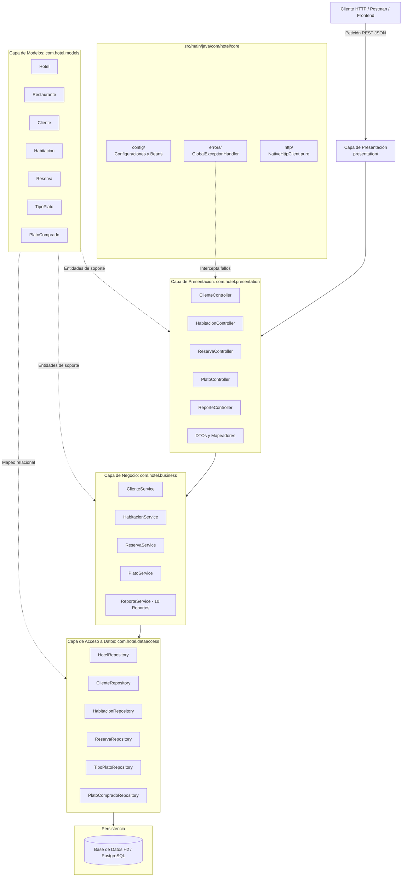

# 📐 Documento de Arquitectura de Software (1_architecture.md)
**Proyecto:** Sistema de Gestión Hotelera y Restaurante (`Hotel`)  
**Estilo Arquitectónico:** Arquitectura en Capas (Layered Architecture) para Spring Boot  
**Referencia Cátedra:** Universidad de Caldas (`backend-ucaldas/ejemplo_backend_capas`)  
**Versión:** 1.0.0  
**Fecha:** Octubre 2026  

---

## 1. Resumen Ejecutivo
El presente documento describe el diseño arquitectónico del backend para el Sistema de Gestión Hotelera y Restaurante. La solución modela la gestión integrada de habitaciones, reservas de huéspedes, catálogo gastronómico del restaurante y registro de compras de platos, permitiendo resolver 10 reportes analíticos de negocio (sumas, conteos, promedios, máximos/mínimos y búsquedas cruzadas).

El sistema se fundamenta en el estilo de **Arquitectura en Capas (N-Tier/Layered Architecture)** conforme a los lineamientos pedagógicos e ingenieriles del repositorio de referencia de la Universidad de Caldas, adaptado idiomáticamente al ecosistema empresarial de **Java 21/25 con Spring Boot 3.4.3**, garantizando separación estricta de responsabilidades, alta cohesión, bajo acoplamiento y ausencia total de dependencias o SDKs comerciales propietarios.

---

## 2. Diagrama de Componentes y Flujo de Información (Mermaid)

---

## 3. Descomposición de Capas del Sistema

Siguiendo la estructura del repositorio de referencia (`presentation`, `business`, `dataaccess`, `models`), el proyecto se distribuye en:

| Capa | Paquete Java | Responsabilidad Principal |
| :--- | :--- | :--- |
| **Presentation** | `com.hotel.presentation` | Expone endpoints REST (`@RestController`). Deserializa y valida payloads de entrada con Jakarta Validation (`@Valid`). Traduce entidades a DTOs de respuesta y entrega códigos de estado HTTP semánticos (200, 201, 400, 404, 500). |
| **Business** | `com.hotel.business` | Implementa las reglas y casos de uso del hotel (`@Service`). Centraliza la lógica de los **10 reportes analíticos** (sumas, conteos, promedios, valorizaciones de compras y búsquedas cruzadas entre hospedaje y consumo). |
| **DataAccess** | `com.hotel.dataaccess` | Abstrae la persistencia mediante interfaces de Spring Data JPA (`@Repository`). Contiene métodos derivados y consultas JPQL optimizadas para agregaciones y filtrados relacionales. |
| **Models** | `com.hotel.models` | Define las entidades JPA correspondientes al modelo del dominio: `Hotel`, `Restaurante`, `Habitacion`, `Cliente`, `TipoPlato`, `Reserva`, `PlatoComprado`. |
| **Core** | `com.hotel.core` | Servicios transversales: configuración global (`config`), manejo centralizado de excepciones con `@RestControllerAdvice` (`errors`), y cliente HTTP puro sin SDKs empaquetados (`http`). |

---

## 4. Registro de Decisiones de Arquitectura (ADR)

### ADR-001: Adopción del Estilo Arquitectónico en Capas (Layered Architecture)
- **Contexto:** Se requiere estructurar el backend del sistema Hotel basándose en la guía didáctica y pedagógica de la Universidad de Caldas (`ejemplo_backend_capas`) y garantizar alta mantenibilidad.
- **Decisión:** Organizar el código fuente estrictamente en las cuatro capas canónicas: `models`, `dataaccess`, `business` y `presentation`.
- **Consecuencias:** 
  - Código desacoplado y altamente legible.
  - La lógica de cálculo de los reportes no contamina los controladores ni la capa de persistencia.
  - Facilidad de testeo unitario e integración.

### ADR-002: Base de Datos en Memoria H2 con Compatibilidad PostgreSQL
- **Contexto:** El proyecto debe ser inmediatamente ejecutable sin requerir que el usuario configure servidores de base de datos externos en su entorno local, pero debe respetar fielmente el modelo relacional corporativo definido en `Diagrama en blanco.pdf`.
- **Decisión:** Configurar H2 Database en modo en-memoria con compatibilidad ANSI SQL / PostgreSQL y carga automática de esquema (`schema.sql`) y datos iniciales de prueba (`data.sql`).
- **Consecuencias:**
  - El proyecto arranca de manera determinista con `./mvnw spring-boot:run`.
  - La transición a un motor PostgreSQL en producción requiere únicamente el cambio de variables de entorno en `application.properties`.

### ADR-003: Prohibición de SDKs Comerciales y Uso de Clientes Nativos
- **Contexto:** Regla de gobernanza técnica que prohíbe SDKs empaquetados propietarios.
- **Decisión:** Implementar cualquier integración externa mediante `java.net.http.HttpClient` nativo de Java 21/25 ubicado en `com.hotel.core.http`.
- **Consecuencias:** Cero vulnerabilidades de dependencias innecesarias, portabilidad total y control milimétrico sobre el ciclo de vida de red.
